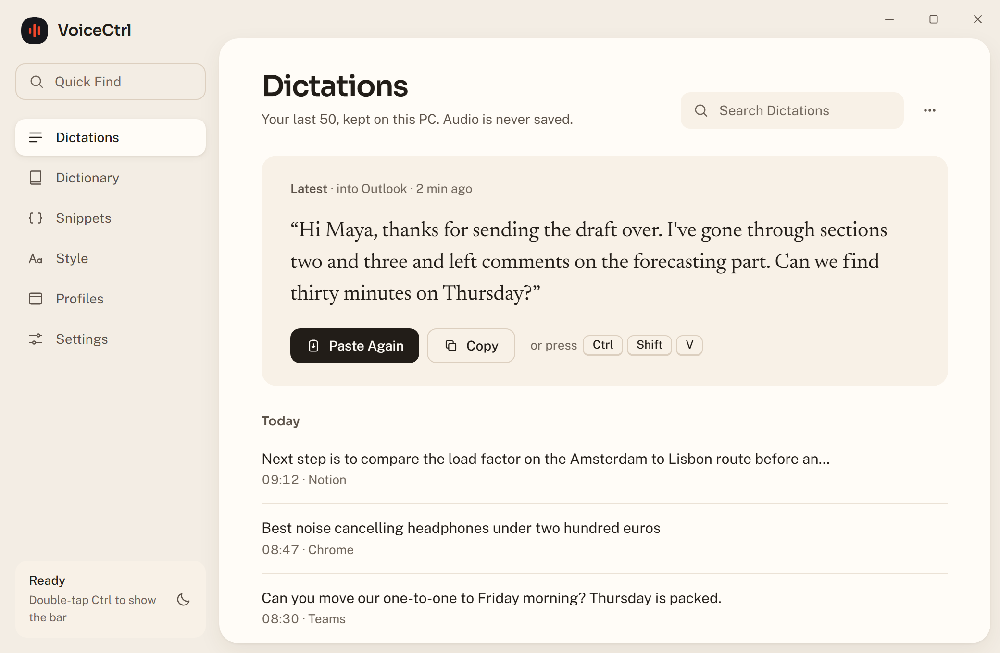
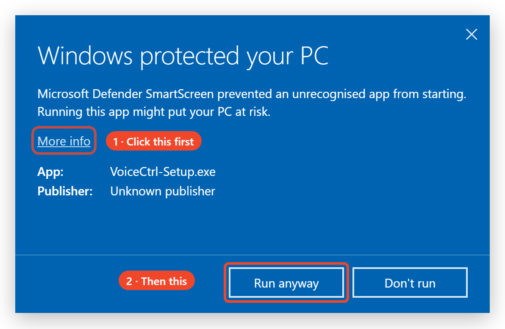
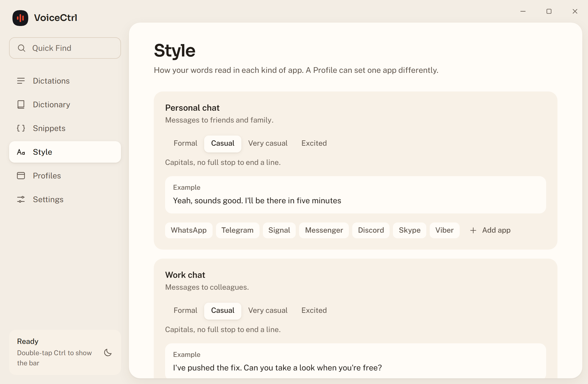
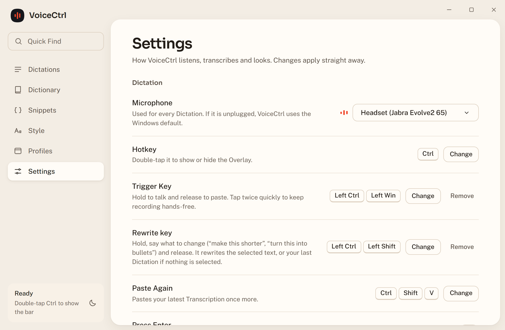

# VoiceCtrl

https://github.com/user-attachments/assets/efb71803-46e7-4902-89c9-3cb5b587a00b

**Talk instead of type, in any app on Windows.** Hold two keys, say it, let go: clean, punctuated text appears where your cursor is. Hold two other keys to rewrite what you've written, or to have an email written for you. It works online or fully offline, and it's free.

### [⬇ Download for Windows](https://github.com/aadershk/VoiceCtrl/releases/latest/download/VoiceCtrl-Setup.exe)

`VoiceCtrl-Setup.exe`, about 90 MB · Windows 10 (22H2) or 11 · free and open source

<picture>
  <source media="(prefers-color-scheme: dark)" srcset="docs/images/hub-dictations-dark.png">
  
</picture>

## Install in 3 steps

1. **Download** [VoiceCtrl-Setup.exe](https://github.com/aadershk/VoiceCtrl/releases/latest/download/VoiceCtrl-Setup.exe) and open it.
2. **Windows will say "Windows protected your PC".** That's normal for a free app from a small developer: VoiceCtrl doesn't pay for a code-signing certificate. Click **More info**, then **Run anyway**.

   

3. **Answer the one setup question:** should VoiceCtrl understand you **Online** (most accurate, needs a free API key) or **Offline** (nothing leaves your PC, a one-time download of about 700 MB)? You can change it any time.

That's it. VoiceCtrl sits by your clock, starts with Windows, and keeps itself up to date.

## How to use it

| Do this | What happens |
| --- | --- |
| **Hold Left Ctrl + Left Win**, talk, let go | Your words are pasted where your cursor is, without the "um"s, with punctuation, set out for the app you're in. |
| Tap **Left Ctrl + Left Win** twice quickly | Hands-free: keep talking without holding anything. Press once more to finish. |
| **Hold Left Ctrl + Left Shift**, say what to change | Rewrites the text you selected ("make this shorter", "turn this into bullets", "translate to Spanish"). Nothing selected? It changes your last Dictation. |
| In Gmail or Outlook, with nothing selected, **hold Left Ctrl + Left Shift** and ask for an email | "Write an email to Mark thanking him for his time" becomes a full email. |
| **Esc** | Cancels the Dictation. |
| **Ctrl + Shift + V** | Pastes your last Dictation again. |
| **Double-tap Ctrl** | Shows a small bar you can click to start and stop, if you'd rather not hold keys. |

You can change the keys in **Settings**.

<picture>
  <source media="(prefers-color-scheme: dark)" srcset="docs/images/hub-style-dark.png">
  
</picture>

The VoiceCtrl window (click the icon by your clock) has your recent **Dictations**, a **Dictionary** for names and jargon it should always spell right, **Snippets** (say "my address", get the whole thing), **Style** for how you write in each kind of app, **Profiles** for one app at a time, and **Settings**.

---

## Privacy and what it connects to

- **Your voice is never saved to disk.** VoiceCtrl keeps only the text, on your PC, and you choose how much (Settings › Privacy › Keep Dictations). One exception, in memory only: a recording you cancel after more than 3 seconds is held for 10 minutes so you can get its text back.
- **No telemetry, no crash reports, no account.** If something goes wrong, Settings › Privacy › **Copy diagnostics** copies a log without your Dictations, keys or file names, for you to paste into a [GitHub issue](https://github.com/aadershk/VoiceCtrl/issues).
- **What it connects to, and when:**
  - **Online** sends your audio to the AI provider you picked: Google Gemini, NVIDIA, OpenAI or another OpenAI-compatible service. Nothing else is sent to them.
  - **Offline** and **Smart cleanup** download their models from Hugging Face (and llama.cpp from GitHub) once, when you set them up. After that, nothing leaves your PC.
  - **Updates** are checked on GitHub.
  - **Word suggestions** with an optional TypeSafe key send recent Dictation text to TypeSafe. Nothing is sent unless you add a key, and never in Offline mode.
- The window inside VoiceCtrl uses Microsoft's WebView2, which is told not to contact Microsoft.
- Your Dictionary, Snippets, Profiles and settings are plain files in `%LocalAppData%\VoiceCtrl`. Your API keys are stored there encrypted for your Windows account.

## Online or Offline

**Auto** (the default) uses Online when you're connected and Offline when you're not. You can pin either one in Settings › Transcription.

- **Online** is the most accurate. It needs an API key from one provider:
  - **Google Gemini** (recommended): a free key from [Google AI Studio](https://aistudio.google.com/apikey). Free keys have a small daily limit; after it, VoiceCtrl switches to Google's lighter Gemini model until the next day.
  - **NVIDIA**: a key from [build.nvidia.com](https://build.nvidia.com/settings/api-keys).
  - **OpenAI**: a key from [platform.openai.com](https://platform.openai.com/api-keys). This preset hasn't been tested with a real key yet.
  - **Other**: any service that speaks OpenAI's chat API, like Groq or OpenRouter, with its address and model.

  If your provider is busy, VoiceCtrl tries your other saved keys, then Offline, so a Dictation is never lost.
- **Offline** runs a speech model on your PC. English is a one-time download of about 700 MB. For other languages, add a language pack in Settings: **European** (25 languages, about 670 MB) or **All languages** (about 1 GB, slower).
- **Smart cleanup** makes Offline write like Online: it removes the "um"s, follows you when you change your mind mid-sentence, and sets out lists, using a small AI model on your PC. **Standard** is about 1.1 GB and quicker; **Better** is about 2.5 GB and closer to Online. Tested in English.

<picture>
  <source media="(prefers-color-scheme: dark)" srcset="docs/images/hub-settings-dark.png">
  
</picture>

## Coming from an older VoiceCtrl

- **From version 3:** just run `VoiceCtrl-Setup.exe`. Your API key, Dictionary, Snippets, Profiles and Dictations carry over, and the Start menu shortcut and start-with-Windows setting move to the new version. Afterwards, delete the old folder you unzipped version 3 into. It isn't used any more.
- **From version 1 or 2:** first quit the old VoiceCtrl (right-click its icon by the clock › Quit), then run `VoiceCtrl-Setup.exe`.

## Uninstall

Windows Settings › Apps › Installed apps › **VoiceCtrl** › Uninstall. It asks whether to also delete your data (Dictionary, Snippets, Dictations, settings and downloaded models). That's unticked by default, so a reinstall picks up where you left off.

## FAQ

**Is it really free?** Yes. VoiceCtrl is free and open source (MIT). Online needs an API key from a provider; Google's free Gemini key is enough for everyday use. Offline costs nothing at all.

**Why does Windows warn me when I install it?** The installer isn't signed with a paid certificate, so Windows doesn't recognise the publisher yet. Every update VoiceCtrl downloads is checked against its own signature before it's installed.

**Can I turn off automatic updates?** Yes: Settings › App › Automatic updates. New versions download quietly and install the next time VoiceCtrl starts.

**Which languages does it understand?** Online: most languages your provider supports. Offline: English, or 25 European languages or about 99 languages with a language pack.

**It pasted into the wrong place, or didn't paste.** Some windows (like ones running as administrator) block pasting. VoiceCtrl then copies the text and tells you to press Ctrl+V. Ctrl+Shift+V pastes your last Dictation again.

**How do I report a problem?** Open a [GitHub issue](https://github.com/aadershk/VoiceCtrl/issues) and paste what Settings › Privacy › Copy diagnostics copies.

## Build it yourself

1. Install the [.NET 8 SDK](https://dotnet.microsoft.com/download/dotnet/8.0) and [Node.js](https://nodejs.org/) 22 or newer.
2. Run `dotnet run --project src\VoiceCtrl`. The first build also installs and builds the interface in `ui\`.

Tests: `dotnet test` for the app, and `npm test` in `ui\` for the interface. The installer is built by `.github/workflows/release.yml`.

## Credits

Offline speech recognition uses NVIDIA's Parakeet models and OpenAI's Whisper through [sherpa-onnx](https://github.com/k2-fsa/sherpa-onnx). Smart cleanup runs Qwen3 models with [llama.cpp](https://github.com/ggml-org/llama.cpp). The installer and updates use [Velopack](https://github.com/velopack/velopack). Music in the video: "Happy Beats & Business Moves Vol. 10" by Sascha Ende ([ende.app](https://ende.app)), CC BY 4.0. Full details are in [THIRD-PARTY-NOTICES.md](THIRD-PARTY-NOTICES.md).

## License

MIT. See [LICENSE](LICENSE).
